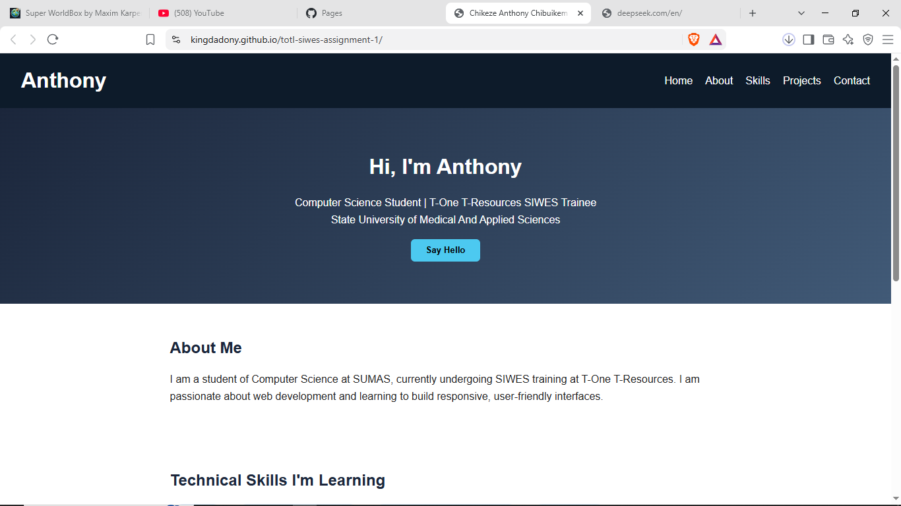
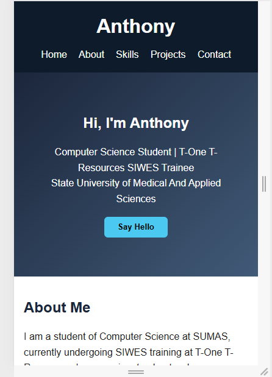

# TOTL SIWES Assignment 1 – Personal Landing Page

## Student Details
- **Full Name:** CHIKEZE ANTHONY CHIBUIKEM
- **Institution:** State University of Medical and Applied Sciences(SUMAS) 
- **Course:** Computer Science
- **GitHub:** https://github.com/KingDadony
- **Live Site:** https://KingDadony.github.io/tolt-siwes-assignment-1/

## Project Description
A responsive personal landing page built as part of the T-One T-Resources
SIWES training. It showcases my background, technical skills, learning
objectives, and contact information, with a small JavaScript interaction.

## Technologies Used
- HTML5
- CSS3 (Flexbox, media queries)
- JavaScript (DOM event handling)
- Git & GitHub
- GitHub Pages (deployment)

## Setup / Viewing Instructions
1. Clone the repo:
   `git clone https://github.com/KingDadony/tolt-siwes-assignment-1.git`
2. Open `index.html` in a browser, or
3. View the live site: https://KingDadony.github.io/tolt-siwes-assignment-1/

## Key Features
- Sticky navigation bar with smooth links
- Hero section with interactive greeting button
- About, Skills, Learning Objectives, and Contact sections
- Fully responsive on mobile and desktop
- Clean, semantic HTML and organized file structure

## Screenshots
### Desktop View

### Mobile View

